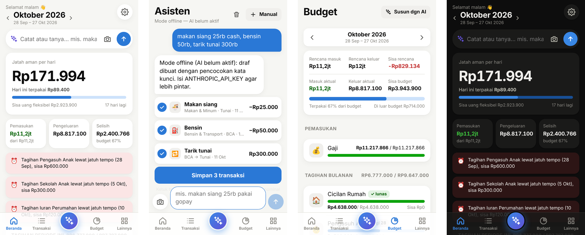

# 💰 MyMoney

Aplikasi keuangan pribadi yang dicatat **secepat chat**. Pengganti Google Sheet budget bulanan: cukup ketik *"beli makan siang 25rb"* atau kirim screenshot mutasi bank, AI yang menentukan kategori, akun yang dipotong, dan tanggalnya.

Dirancang untuk dipakai dari **Safari iPhone** (bisa dipasang di Home Screen seperti aplikasi), berjalan di **Docker** di komputer/server rumah Anda, dan sangat ringan: image ±15 MB, RAM ±20 MB.



---

## Fitur

### ✨ AI (Claude Opus 5.5)
| Fitur | Contoh |
|---|---|
| **Catat dari kalimat bebas** | `makan siang 25rb cash` · `tarik tunai 300rb` · `kemarin topup gopay 100k` · `gajian 11.217.866` · `bensin 50rb, parkir 5rb` (beberapa transaksi sekaligus) |
| **Tanpa nominal pun bisa** | `beli makan siang` → nominal ditebak dari kebiasaan Anda (ditandai *perkiraan*, tinggal dicek) |
| **Tanya jawab keuangan** | `sisa budget makan berapa?` · `pengeluaran terbesarku apa?` · `kapan terakhir bayar internet?` · `bandingkan dengan bulan lalu` |
| **Scan screenshot mutasi** | Kirim 1–10 screenshot myBCA / m-banking / GoPay → semua baris terbaca, deskripsi dirapikan (`TRANSAKSI DEBIT QR 914 Nasi Bebek` → *Nasi Bebek*), top-up & tarik tunai dikenali sebagai transfer, yang sudah pernah dicatat ditandai duplikat |
| **Impor mutasi** | Tempel teks mutasi KlikBCA, unggah Excel/CSV (termasuk file Google Sheet lama), atau PDF e-statement |
| **Susun budget dengan AI** | Tempel daftar budget dari Google Sheet → dipetakan ke kategori, tagihan bertanggal dikenali, kategori baru dibuat otomatis |
| **Analisis periode** | Ringkasan pola belanja + saran hemat yang konkret |
| **Belajar dari koreksi** | Setiap kali Anda menyimpan/mengoreksi, AI mengingat pola *deskripsi → kategori & akun* |

### 🆓 Mode gratis (tanpa kredit AI)
Tanpa API key, aplikasi tetap pintar dan **100% gratis** — semua diproses di komputer Anda:
- **Catat dari kalimat**: `makan siang 25rb cash`, `tarik tunai 300rb`, `topup gopay 100k`, `kemarin bensin 50rb, parkir 5rb` → kategori, akun, tanggal, dan transfer dikenali dari kata kunci, alias akun, dan kebiasaan Anda. Tanpa nominal (`makan siang`) → nominal ditebak dari transaksi serupa sebelumnya.
- **Scan screenshot mutasi**: dibaca dengan **OCR Tesseract** (sudah terpasang di image Docker), lalu baris mutasi dikenali (tanggal, nominal, DB/CR, top-up & tarik tunai), dikategorikan, dan dicek duplikatnya.
- **Tempel teks mutasi** (KlikBCA/myBCA) juga bisa.
- Belum bisa tanpa AI: tanya-jawab, baca PDF, susun budget otomatis, dan analisis. Hasil OCR sedikit kurang rapi dibanding AI — selalu periksa draf sebelum menyimpan.

### 📊 Pengelolaan keuangan
- **Periode keuangan mulai tanggal gajian** (default 28): periode *Oktober* = 28 September – 27 Oktober. Bisa diubah di Pengaturan.
- **Akun/kas**: BCA, Tunai, GoPay, ShopeePay, DANA, Flazz, kartu kredit… saldo dihitung otomatis; **Sesuaikan saldo** bila berbeda dengan aplikasi bank.
- **Transfer antar akun** (tarik tunai, top up) tidak terhitung sebagai pengeluaran.
- **Budget per kategori** yang **otomatis terbawa** ke periode berikutnya, lengkap dengan:
  - **Tagihan bertanggal** (cicilan rumah tgl 28, internet, SPP…) → muncul di Beranda dengan tombol **Bayar** dan pengingat jatuh tempo.
  - **Jatah aman per hari** = sisa uang fleksibel ÷ sisa hari periode.
  - Peringatan budget hampir habis / terlampaui, dan pengeluaran di luar budget.
- **Utang & cicilan** (Kredivo, SPayLater, Indodana, …): sisa tagihan, progres, riwayat bayar.
- **Laporan**: per kategori/grup, grafik harian, tren 6 periode, pengeluaran terbesar, per akun.
- **Ekspor Excel/CSV** dan **backup database** satu klik.
- **iPhone Shortcut & Siri**: *"Hey Siri, catat pengeluaran"* → langsung tersimpan tanpa membuka aplikasi.
- Mode gelap, PWA (ikon di Home Screen), login dengan kata sandi.

---

## Menjalankan dengan Docker

Butuh [Docker Desktop](https://www.docker.com/products/docker-desktop/) (Mac/Windows) atau Docker Engine (Linux/NAS).

```bash
# 1. Ambil kode
git clone -b claude/bold-turing-wo2evh https://github.com/ganova/mymoney.git
cd mymoney

# 2. Buat file konfigurasi, lalu edit (isi APP_PASSWORD dan ANTHROPIC_API_KEY)
cp .env.example .env

# 3. Jalankan
docker compose up -d --build
```

Buka **http://localhost:7428** dan masuk dengan `APP_PASSWORD`.

Perintah lain:
```bash
docker compose logs -f mymoney    # lihat log
git pull && docker compose up -d --build   # perbarui ke versi terbaru
docker compose down               # hentikan (data tetap aman di volume)
```

### Mendapatkan API key AI
1. Daftar/masuk di https://console.anthropic.com → **Settings → API Keys → Create Key**.
2. Isi saldo kredit (Billing).
3. Tempel ke `.env`: `ANTHROPIC_API_KEY=sk-ant-...` lalu `docker compose up -d`.

Model default `claude-opus-5-5` (paling pintar). Perkiraan biaya pemakaian pribadi sehari-hari kecil; pemakaian token & perkiraan biaya bisa dipantau di **Pengaturan → AI**. Untuk lebih hemat, ganti `AI_MODEL=claude-sonnet-5-5` atau `claude-haiku-5-5`.

> Permintaan ke model Opus/Sonnet 5.5 memakai *server-side fallback* (`fallbacks: "default"`): bila classifier keamanan menolak permintaan, API otomatis mencoba model cadangan. Matikan dengan `AI_FALLBACKS=false` bila tidak diinginkan.

---

## Memakai dari iPhone

### Di jaringan Wi-Fi rumah
1. Cari IP komputer yang menjalankan Docker (mis. `192.168.1.10`).
2. Di Safari iPhone buka `http://192.168.1.10:7428`.
3. Ketuk **Bagikan → Tambahkan ke Layar Utama**. MyMoney kini tampil seperti aplikasi.

### Dari mana saja (disarankan)
Pilih salah satu:

- **Tailscale** (gratis, paling mudah & aman): pasang Tailscale di komputer dan iPhone, login dengan akun yang sama, lalu buka `http://nama-komputer:7428`. Untuk HTTPS: `tailscale serve --bg 7428` → buka `https://nama-komputer.tailnet-xxx.ts.net`.
- **Cloudflare Tunnel** (domain sendiri): buat tunnel di dasbor Cloudflare Zero Trust, arahkan hostname ke `http://mymoney:8080`, isi `CLOUDFLARE_TUNNEL_TOKEN` di `.env`, lalu:
  ```bash
  docker compose --profile tunnel up -d
  ```

> Wajib isi `APP_PASSWORD` yang kuat bila aplikasi bisa diakses dari internet. Dengan HTTPS, aplikasi juga bisa bekerja offline (service worker) dan menyalin teks ke clipboard.

### iPhone Shortcut / Siri
1. Di MyMoney: **Lainnya → Pengaturan → iPhone Shortcut → Buat token Shortcut**, salin tokennya.
2. Di app **Pintasan (Shortcuts)** buat pintasan baru:
   - **Minta Input** (Teks) → "Catat apa?"
   - **Dapatkan Isi URL**: `https://ALAMAT-ANDA/api/shortcut/ask`, metode **POST**, header `Authorization: Bearer TOKEN`, isi **JSON** dengan kunci `text` = *Input yang Diberikan*
   - **Tampilkan Hasil**
3. Ucapkan *"Hey Siri, Catat Pengeluaran"* → *"makan siang dua puluh lima ribu"* → tersimpan, dan Siri menyebut sisa jatah harian.

Untuk screenshot: pintasan dengan **Tampilkan di Lembar Berbagi** (Gambar) → **Konversi Gambar** ke JPEG → POST ke `/api/shortcut/scan` sebagai **Formulir** dengan kunci `image`. Transaksi baru (yang bukan duplikat) langsung tersimpan.

---

## Pindah dari Google Sheet

1. Buka **Budget → Susun dengan AI**, tempel daftar budget Anda (atau unggah file `.xlsx` hasil *File → Download* dari Google Sheet). Periksa hasilnya → **Terapkan**.
2. Buka **Lainnya → Akun & Saldo**, isi saldo awal tiap akun (atau pakai **Sesuaikan** agar sama dengan saldo di m-banking).
3. (Opsional) **Lainnya → Impor Mutasi → File** untuk memasukkan transaksi lama dari sheet "Actual".
4. Tambahkan utang/paylater yang masih berjalan di **Utang & Cicilan**.

Mulai periode berikutnya budget otomatis disalin; tinggal mencatat.

---

## Backup & pemulihan

- **Lainnya → Backup database** mengunduh file `.db` lengkap. Simpan berkala di iCloud/Google Drive.
- **Lainnya → Excel semua transaksi** untuk arsip yang bisa dibuka di Excel/Sheets.
- Data tersimpan di volume Docker `mymoney_mymoney-data`. Memulihkan dari file backup:
  ```bash
  docker compose stop mymoney
  docker run --rm -v mymoney_mymoney-data:/data -v "$PWD":/backup alpine \
    sh -c 'rm -f /data/mymoney.db-* && cp /backup/mymoney-backup-YYYYMMDD.db /data/mymoney.db && chown 10001:10001 /data/mymoney.db'
  docker compose start mymoney
  ```

---

## Konfigurasi (`.env`)

| Variabel | Default | Keterangan |
|---|---|---|
| `APP_PASSWORD` | *(kosong)* | Kata sandi login. Kosong = tanpa login (hanya untuk jaringan pribadi) |
| `ANTHROPIC_API_KEY` | *(kosong)* | API key Claude. Kosong = mode offline |
| `AI_MODEL` | `claude-opus-5-5` | `claude-sonnet-5-5` / `claude-haiku-5-5` untuk lebih hemat |
| `AI_EFFORT` | `low` | Kedalaman berpikir untuk catat cepat & tanya jawab |
| `AI_VISION_EFFORT` | `medium` | Untuk screenshot, impor, susun budget |
| `AI_FALLBACKS` | `true` | Server-side fallback bila permintaan ditolak classifier |
| `TZ` | `Asia/Jakarta` | Zona waktu (menentukan "hari ini" & periode) |
| `PORT` | `7428` | Port di komputer Anda |
| `CLOUDFLARE_TUNNEL_TOKEN` | *(kosong)* | Untuk profil `tunnel` |

Tanggal mulai periode, akun default, nama, dan *simpan otomatis* diatur dari halaman **Pengaturan**.

---

## Arsitektur

```
iPhone Safari (PWA, Svelte 5)
        │  JSON API + cookie sesi / Bearer token (Shortcut)
        ▼
Go 1.26 — satu binary (frontend tertanam)
  ├─ internal/store    SQLite (modernc, tanpa CGO, WAL) — akun, transaksi, budget, utang, aturan
  ├─ internal/period   periode keuangan mulai tanggal gajian
  ├─ internal/ai       Claude via anthropic-sdk-go: asisten (tool use), ekstraksi (vision +
  │                    structured output), budget, analisis, parser offline
  └─ internal/server   HTTP API, login, ekspor Excel, iOS Shortcut
```

- **Asisten**: satu model dengan tool `catat_transaksi`, `ringkasan_periode`, `cari_transaksi`, `saldo_dan_utang`. Konteks berisi akun, kategori, utang, aturan yang dipelajari, dan kebiasaan 4 bulan terakhir (di-cache dengan prompt caching).
- **Scan/Impor**: gambar diperkecil di iPhone (maks 2576 px) lalu dibaca dengan *structured output* (JSON schema) sehingga hasilnya selalu valid; duplikat dicek terhadap database.
- Semua nominal disimpan sebagai bilangan bulat Rupiah.

### Pengembangan

```bash
make dev    # backend di :8080 (data di ./data)
make web    # frontend hot-reload di :5173 (proxy /api ke :8080)
make test   # tes Go
make check  # go vet + svelte-check
```

Struktur: `cmd/mymoney` (main), `internal/*` (backend), `web/src` (frontend: `pages/`, `components/`, `lib/`).
